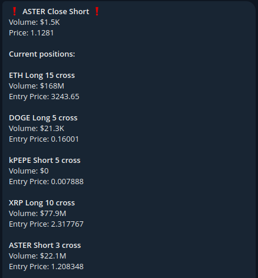

# Hyperliquid Wallets Monitor

Telegram bot that monitors positions of configured Hyperliquid wallets. Alerts
contain the latest detected fill, current positions, changes since the current
alert started, P&L, and a link to Hyperdash.



## Project structure

```text
walletwatcher/
  app.py             Dependency assembly, compatibility facade and worker lifecycle
  config.py          Environment configuration and project paths
  domain/            Position/portfolio/credential values and pure validation
  services/          Monitoring, portfolio queue, diagnostics and live access policy
  hyperliquid/       API parsing, HTTP facade, shared budget and portfolio reads
  storage/           Wallet files, encrypted credentials and delivery queue
  trading/           Pure trading policy, exchange gateway and autoclose execution
  presentation/      Telegram controller, command responses and portfolio formatting
  infrastructure/    Logging, watchdogs, process supervisor and health check
tests/               Offline regression tests and an opt-in live API check
```

`hyperliquid/client.py` keeps the shared API facade. `rate_limit.py` owns rolling
request accounting and dynamic trading priority; `snapshots.py` owns WebSocket
connection limits; `portfolio.py` owns the temporary sessions used by `/my` and
`/wallet`. `parsing.py` translates API JSON into domain values without importing
Telegram presentation. Domain values and validation have no adapter or external
package dependencies. Existing model/parser imports remain available through
compatibility exports in the old presentation and credentials modules.
`trading/policy.py` contains Decimal calculations and position lifecycle checks
without HTTP or SDK dependencies. `TradingGateway` describes the exchange
operations used by the autoclose worker, and `TradingAPI` implements them using
the managed client. Persistent rule/attempt formats are unchanged.
`Application` composes these adapters and supervises workers. The Telegram
controller parses commands; monitoring and portfolio services own their state
and loops. Shared settings keep access changes visible to every service.
The autoclose worker receives credentials, live access checks, shared request
control and shutdown explicitly through narrow contracts in `trading/ports.py`;
it neither receives the application nor constructs an exchange adapter.
Existing command/worker entry points and the `PortfolioRequest` import remain
available as a compatibility facade without duplicate state.
Architecture tests guard layer boundaries, compatibility imports and static
import cycles alongside behavioral regression tests.

Docker copies the `walletwatcher` package into `/app` and starts
`python -m walletwatcher.infrastructure.supervisor`; the supervisor starts the
bot with `python -m walletwatcher.app`. The health check runs as
`python -m walletwatcher.infrastructure.healthcheck`. Compose commands are
unchanged. `.env` stays in the repository root, while the configured persistent
data paths and volume contents stay unchanged.

## Setup

The application runs **only in Docker**. Install Docker Engine with Compose
2.24+ on Linux, or Docker Desktop on macOS/Windows. No local Python environment
is required. The image uses Python 3.12, pinned application dependencies, and a
non-root user (UID/GID 10001). Direct host launches of `walletwatcher.app` and
`walletwatcher.infrastructure.supervisor`
are rejected before configuration is loaded or network requests are made.

```sh
cp .env.example .env
```

Fill in `.env`:

```dotenv
BOT_TOKEN=123456789:token_from_BotFather
CHAT_IDS=123456789,-1001234567890
ADMIN_ID=123456789
MODE=TEST
```

`CHAT_IDS` contains authorized **chat IDs**, not an independent user allowlist.
Anyone who can write in an authorized group can manage its tracked wallets.
`TEST` sends broadcasts and trade alerts only to `ADMIN_ID`; command replies are
sent to the authorized chat that invoked the command. Use `PROD` to send alerts
to every configured chat. Users must start the bot, or add it to their group,
before it can send them messages.

Wallets can be added with Telegram commands after startup. The optional
`/data/wallets.txt` file inside the container uses one wallet per line:

```text
0x0123456789012345678901234567890123456789;whale
0xabcdefabcdefabcdefabcdefabcdefabcdefabcd;
```

Addresses are normalized to lowercase. Blank lines and comments beginning with
`#` are ignored. Malformed lines are logged and skipped. Wallets, the SQLite
outbox and instance locks are stored in the named volume `walletwatcher_walletwatcher-data`.
The `.env` file stays on the host and is injected at runtime; it is never copied
into the image. Source code is baked into the image, so changes require rebuilding.

### Hyperliquid API compatibility (verified 2026-10-04)

The public mainnet `POST https://api.hyperliquid.xyz/info` endpoint remains current.
Both `clearinghouseState` and `userFills` with `aggregateByTime=true` were checked
against current documentation, the official Python SDK and live responses.
Use the actual master/subaccount/vault address; an agent/API-wallet address can
return empty account data.

| Call or link | Current behaviour |
| --- | --- |
| `clearinghouseState` | Uses explicit `dex`; reads `assetPositions[].position` |
| `userFills` | Returns up to 2000 fills, including original perps, HIP-3 and spot |
| `entryPx` | May be `null`; rendered as `N/A`. Zero-size positions are excluded |
| Hyperdash wallet link | Uses `https://hyperdash.com/address/<wallet>`; `/trader/` redirects there |

`PERP_DEXS=main` monitors the original perpetual market by default, preserving
the project's original scope. To include a HIP-3 market, set e.g.
`PERP_DEXS=main,xyz`. Names can be discovered with the documented `perpDexs` info
request. Each configured dex is queried separately. A partial failed snapshot
is rejected, so API failures cannot falsely close another dex's positions.
Spot is not monitored. Fill selection excludes spot/unconfigured dexes and matches
the assets whose positions changed, including positions that were closed.

The API currently permits 1200 request-weight units per minute per IP:
`clearinghouseState` costs 2; `userFills` costs 20 plus returned-item weight.
The client uses a conservative 1000-unit sliding-minute budget, reserving the
maximum fill-response weight before a request. Other software on the same IP
can still cause 429 responses; the shared cooldown observes `Retry-After`, including
HTTP dates. More wallets/dexes increase polling latency.

Sources: [perpetual account API](https://hyperliquid.gitbook.io/hyperliquid-docs/for-developers/api/info-endpoint/perpetuals),
[fills API](https://hyperliquid.gitbook.io/hyperliquid-docs/for-developers/api/info-endpoint),
[request limits](https://hyperliquid.gitbook.io/hyperliquid-docs/for-developers/api/rate-limits-and-user-limits),
[official SDK](https://github.com/hyperliquid-dex/hyperliquid-python-sdk/blob/master/hyperliquid/info.py).

## Running

After filling in `.env`, start the application:

```sh
docker compose up -d --build
docker compose ps
docker compose logs -f --tail=100
```

Stop gracefully with `docker compose stop`; resume with `docker compose up -d`.
After changing code or `.env`, run `docker compose up -d --build` again to recreate
the container. `docker compose restart` does not reload the environment file.
Missing or invalid credentials produce a clear configuration error (exit 78);
stop the container, correct `.env`, then recreate it.

If building fails at `COPY walletwatcher/ ./walletwatcher/` with
`"/walletwatcher": not found`, verify that `walletwatcher/app.py` exists in the
checkout and that `.dockerignore` is the current repository version. Old ignore
files that allowed only root-level Python files exclude the package directory.
Update both the source tree and `.dockerignore` before rebuilding. The checked-in
rules include the package and test Python files, including nested directories.

`docker compose down` removes containers and preserves wallet/outbox data.
**`docker compose down -v` deletes that data permanently.** Do not run multiple
containers or installations with the same Telegram token: polling returns 409
conflicts. Locks prevent simultaneous processes sharing this volume; different
volumes cannot coordinate Telegram polling.

Commands:

- `/help` — list available commands, required arguments and their meanings;
  personal-only commands are marked explicitly. Replies go to the requesting chat.
- `/addwallet 0x...`
- `/removewallet 0x...`
- `/settag 0x... some tag` (at most 100 characters, without semicolons/newlines)
- `/creds <address> <private key API wallet>` (private chat only)
- `/my` (private chat only)
- `/wallet <address>` — fresh portfolio for any public address, in the `/my`
  format; no credentials or monitoring registration required.
- `/autoclose <wallet> <ticker>` (private chat only)
- `/cancelautoclose <wallet> <ticker>` (private chat only)
- `/autocloses` — list your active rules (private chat only, no arguments).
- `/intersections` — list positions in tickers held by at least two tracked
  wallets (no arguments).
- `/health` — local worker, monitoring, API budget and Telegram delivery diagnostics
  (no arguments; replies only to the requesting authorized chat).
- Any other text shows wallets, per-wallet last successful update, failure
  counts and the number of queued notifications.

Changes to wallets and tags are written immediately using a temporary file,
`fsync` and atomic replacement. The command does not confirm success before saving.
Wallet lists start with `Wallets: <count>` and follow the order of tracked wallets
in `wallets.txt`, including manual reordering while the bot is running. Wallet
commands preserve that order; new wallets are appended at the end. If the file
cannot be read, the list uses the current in-memory order.

`/intersections` groups exact full tickers alphabetically, including HIP-3 names
such as `xyz:SPCX`. Long and short positions in the same ticker count together;
`BTC` and `xyz:BTC` are separate instruments. Wallets within each ticker follow
the file order. Each block contains the tag (when present), a copyable address,
and the same four position lines as alerts: position title, Volume, Entry Price
and P&L, including existing position annotations. Blank lines separate blocks.
Long reports split between complete blocks without dropping positions.

The command uses the last snapshots collected by ordinary monitoring and sends
no additional exchange requests. Prices and P&L follow the existing monitor
refresh rules. Wallets without a first successful snapshot are excluded with a
notice. Authorized private and group chats can request the report without
personal credentials; it is sent only to the requesting chat.

`/health` reads local state without contacting Hyperliquid, decrypting credentials,
reserving request weight or restarting workers. A healthy response is three short
lines: overall status, wallet/worker counts, API weight and pending notifications.
Private chats add your active rule count; active portfolio requests and routine
autoclose priority may add a short status line.

Only affected components receive detailed sections. Monitoring expands for failed
or never-checked wallets, a missing cycle, or data/cycles older than
`max(60 seconds, 3 * POLL_INTERVAL)`. All five workers must be present and running.
API details expand for exchange cooldown, waiting trading requests or an exhausted
budget; yielding to scheduled/triggered autoclose alone is normal. Telegram
details expand for retries, delivery cooldown, chat wait over 10 seconds or a
notification overdue by more than 30 seconds (age measured from its due time).
Ordinary short delivery throttling and ready queue entries do not signal errors.
Detailed responses include uptime, but omit healthy components' diagnostics. A
recent monitor cycle alone does not establish that wallet data is fresh.

In an authenticated private chat, current activation/check errors or unconfirmed
orders expand your queued/armed/closing counts and error details (including
terminal rules still awaiting reconciliation). It does not list historical failures that
have already completed. Groups and mismatched private identities receive only
shared operational counters. Other users' trading details and notification
contents are never included. Reports use the normal durable delivery queue and
remain subject to Telegram delivery waits. Diagnostic reads leave worker
heartbeats, trading priority, rule state and request accounting unchanged.

### Personal account commands

Add your personal Telegram chat ID to `CHAT_IDS` to use these commands in a
private conversation with the bot. Group chats cannot use `/creds` or `/my`;
`/wallet <address>` is available in any authorized chat for an explicitly supplied
public address. Credentials are bound to the authenticated
`message.from_user.id` and the bot identity; replies go only to that user,
including in `MODE=TEST`.

`/creds <address> <private key API wallet>` saves or replaces your own account
address and API/agent-wallet key. Use the actual trading account address, not
the agent address. This stores credentials; it does not verify the agent's
approval or ownership. Trading is enabled only by an explicit `/autoclose` rule,
which verifies trading authority separately. The key is validated as a
secp256k1 private key. Never send a seed phrase or the main wallet's key.

The bot tries to delete the incoming credentials message, including rejected
group messages in authorized chats. If deletion fails, the private confirmation
asks you to remove it manually. Sending a secret as a Telegram command still
passes it through Telegram; deleting the message does not make that transport
an end-to-end encrypted secret channel. Use a dedicated, revocable API wallet.
Keys are not echoed in replies or recorded as plaintext in the database/outbox.
Application log formatting also redacts private-key-shaped strings.

Credentials are encrypted with Fernet before being saved in `state.sqlite3`.
The application creates `/data/credentials.key` on first registration with
owner-only permissions (`0600`). It survives restarts in the persistent volume
and must be backed up alongside the database and its WAL files. Do not delete
or regenerate it after credentials have been saved. Encrypting the database
does not protect against an attacker who can read both the database and this
key file or control the running application.

`/my` uses only your saved public address and fetches a fresh snapshot.
`/wallet <address>` uses the supplied address and the identical balance/position
formatter, including prices, P&L, funding and TP/SL. It neither reads nor changes
credentials or the tracked wallet list. Only when either command is requested,
the dedicated supervised `personal` worker opens a WebSocket subscription to
`allDexsClearinghouseState`, receives the main and HIP-3 account states together,
and closes the connection before requesting prices and TP/SL for occupied DEXs.
The account-mode request runs alongside the snapshot. Then prices, TP/SL and
the unified-account balance (when applicable) load in parallel, with at most
four request threads per command. Each HTTP thread owns a separate session;
these sessions close when the command finishes. Personal API requests do not
hold the monitor's HTTP connection lock. Both paths use one thread-safe IP
weight budget and 429 cooldown; an API limit can still defer both paths.
Telegram polling queues `/my` and `/wallet` and continues accepting commands while
the personal worker fetches the result. At most 32 requests can wait in memory;
repeated `/my` from the same user shares that user's pending result. Repeated
`/wallet` for the same normalized address and chat shares its queued/in-flight
result; different addresses and chats remain independent. The two commands share
the same bounded queue and worker. If the queue is full, the bot asks the user to
retry later. A changed account address
during fetching prevents the old `/my` portfolio from being sent, while an explicit
`/wallet` address remains independent of credentials changes. Revoked chat access
or shutdown discards queued/in-flight results and errors. Requests awaiting
collection are not persisted; repeat `/my` or `/wallet` after a process restart. Once a
result is queued for Telegram delivery, the existing durable outbox applies.
No connection or background subscription is kept between commands. Connection
setup has a 5-second timeout, snapshot collection a 20-second overall deadline,
and closing the socket waits at most 1 second. At most 30 connection attempts
per minute are allowed per client, including failed attempts. There is no
automatic reconnect or fallback to a sequential DEX scan; repeat `/my` or `/wallet` after a
failure. This is independent of the monitor's `PERP_DEXS` filter and does not
change monitoring. Spot positions are not listed. Long portfolios
are split into multiple complete HTML messages, without omitting positions.
An unavailable API or incomplete snapshot produces a retry message rather
than a misleading partial portfolio.

### One-shot autoclose

After saving `/creds`, send `/autoclose 0x... BTC` in your authorized private
chat. The source address must already be tracked. Use the full ticker for
HIP-3 perps, e.g. `xyz:EWZ`; this works independently of `PERP_DEXS`.
The asynchronous activation confirms both open positions and the saved key's
authority. Main accounts and subaccounts are supported; vault trading is rejected.
Temporary network failures, HTTP 429/5xx and the shared request budget defer
activation instead of immediately deleting the request. Validation makes at most
three attempts, respecting the cooldown and a five-minute overall deadline. The bot
reports that activation is pending; no rule is armed until validation succeeds.
Retries repeat the fresh position checks, so the baseline belongs to successful
activation. Queued retries survive restarts and can be cancelled normally.
HTTP 4xx other than 408/429 and invalid JSON fail immediately. Safe diagnostics
identify the activation stage, request type and HTTP status or local budget;
response bodies, keys and request payloads are never included. These retries
apply only to activation, never to an order with an uncertain outcome.
Use a dedicated API agent for this bot so another trading process does not compete
for the same signer's nonces.

The source baseline is its signed quantity at activation. When a subsequent
snapshot shows **less than 10%** remaining in the original direction, the bot
closes your entire current position in that ticker, in either direction.
Exactly 10% does not trigger. Source increases do not reset the baseline; a
source reversal counts as a full close. A temporary dip and recovery between
checks does not trigger. Checks run in a separate supervised worker, with
`POLL_INTERVAL` between cycles; API cooldowns and request time can delay them.
The worker has its own HTTP session and shares the application's IP rate budget.
Wallet/DEX snapshots are shared between rules within a cycle; a fresh user
snapshot is mandatory immediately before each order.
While rules are waiting for their source trigger, monitoring and `/my` can use
spare capacity in the shared 1000-unit rolling-minute request-weight budget.
Before admitting ordinary traffic, the limiter forecasts scheduled autoclose
checks until the proposed request expires from the rolling window. It protects
a complete waiting-rule check (two position snapshots plus the maximum fill-page
weight), including bootstrap history if no
saved anchor exists. Weight expiring before that deadline remains available now.
This avoids monitoring consuming the capacity needed for the next poll, without
lengthening `POLL_INTERVAL` or skipping position lifecycle checks. With a saved
anchor, one protected check needs at least 124 weight units. Repeated checks use
their observed response weights, with a floor for a quiet cycle (25 per anchored
rule); the forecast retains headroom for one maximum-size reservation. The
estimate rises and falls with actual cycle costs, the polling interval and the
active rules. It is not a charge or a permanently separate quota. A deliberate
monitor pause does not increase wallet failure counters or backoff.
If a trading request cannot fit, its required weight is dynamically protected
from ordinary requests until it is admitted or no longer needed. Other free
capacity remains available to monitoring. Smaller trading requests do not clear
a larger pending request's priority. No fixed 600-unit reserve is held.
Already spent weight cannot be reclaimed: trading may still wait for earlier
requests to leave the rolling window. The total never exceeds 1000. Local budget
refusal delays only the request that does not fit; a genuine HTTP 429 still
blocks every worker for `Retry-After`.

The first local budget shortage is reported immediately, including during close
preflight. Each stage/cause and order context has a durable quiet window: the
same warning can recur after 60 seconds without that failure. Switching between
already reported stages or an individual successful check does not reopen the
window. These markers survive restarts, and existing waiting-rule markers remain
supported. A new stage/cause, source trigger, order attempt or unknown order
outcome is reported immediately. IOC rejections, partial fills and final results
are reported separately. Request order, polling frequency, trading priority and
fresh history validation are unchanged; deduplication does not remove an actual
budget wait. Waiting-rule notices say that no close order has been submitted.

As soon as a source trigger is observed, closing becomes exclusive: ordinary
REST requests (monitoring and `/my`) and idle/queued autoclose checks pause.
Validation, signing, submission, retries and confirmation of the closing rule
take priority. Monitor pauses do not count as wallet failures or increase its
backoff. Priority survives restarts and ends on confirmed completion,
cancellation without an in-flight order, source recovery before submission,
or final failure. Terminal unresolved orders remain fenced against new trading
without indefinitely pausing unrelated monitoring. Already admitted HTTP requests
cannot be recalled, and already spent API weight must still expire normally.

The rule follows your original position. Its fill history is checked even when
the net position size is unchanged. Manual closure, reversal, TP/SL or liquidation
ends that lifecycle; a reopened position does not inherit the rule. Incomplete,
truncated or inconsistent history stops the rule without placing a new order.
An initial or legacy rule reads recent fills to establish a saved fill anchor;
bootstrap conservatively stops if 2000 recent fills do not reach the checkpoint.
Subsequent polls request only fills from that anchor onward and require the
saved fill to remain present, detecting retention gaps even if a close/reopen
left position size unchanged. Identical history snapshots are shared within a
cycle; validation immediately before submitting always bypasses that cache.
Source positions, own positions and lifecycle history are still checked each
poll. The exchange cannot atomically bind an order to one opening:
manual close/reopen racing with final validation and order submission remains an
API limitation. Avoid simultaneous manual trading during execution.

Market close uses a signed `reduceOnly` IOC limit order. The price limit is fixed
at 1% from the fresh midpoint before the first attempt, rounded inward to valid
perpetual price precision. It is never widened. At most three submissions are
made, at least two seconds apart, using the actual remaining size. An IOC may
partially fill or fail to match; after the final attempt the bot reports the
remainder. Existing TP/SL orders are not modified.

Rules, boundary fill IDs, monotonic nonces, client order IDs and attempts are
saved in SQLite before submission. After a restart or timeout the worker checks
the old order and fills first; an uncertain request is never blindly replayed.
Requests expire after 15 seconds. If their outcome remains unknown after expiry
and a five-second reconciliation grace period, the rule stops and asks you to
check the account. A successful HTTP response alone is insufficient: actual fills
and a zero position remainder must be confirmed. The final private notification
includes quantity, average execution price, account and source. Rule completion
and its notification commit together; the durable delivery queue handles retries.
Active-rule request failures are saved with their stage and safe diagnostics.
Failures are immediately queued for the owner with a safe explanation of the
failed stage and whether closure is confirmed, retrying or stopped. Identical
continuing failures are deduplicated, including after restart; a new cause or
new outage is reported again. Each failed activation attempt, rejected IOC,
reported partial fill and unverified order outcome is also explained. Late
reconciliation failures are reported while retaining the order fence. Fatal
non-retryable errors before submission stop the rule and release monitoring.
Telegram outages or flood waits can delay actual delivery; the durable outbox
retries it. A local refusal before HTTP submission is
journaled as not submitted and retried after budget recovery, without creating
an unknown-order block. It still consumes one of the three close attempts.
Actual transport failures remain uncertain and must be reconciled before retry.
An unresolved order also blocks other rules for that account and ticker. Late
read-only reconciliation continues after failure; a definitive exchange status
releases this block, and a subsequently confirmed full close updates the final
notification without submitting another order.

`/cancelautoclose 0x... BTC` records cancellation immediately and prevents further
submissions. An already submitted request may still fill; the worker reconciles
it and reports the result. Removing the source, replacing credentials (even with
the same address) or removing the user's personal chat from `CHAT_IDS` also
cancels their rules. No notification is sent to a revoked chat. Multiple source
rules may target one position, but only one unresolved order can exist for that
account and ticker. Success, cancellation or final failure ends the rule; send a
new `/autoclose` command to arm it again.

`/autocloses` lists only your active rules in creation order, one per line:
`0x...` followed by the ticker (e.g. `BTC` or `xyz:SPCX`). Addresses are formatted
as inline code for copying. Cancelled and completed rules are omitted immediately;
an empty list returns `You have no active autoclose rules.` No exchange request
or private-key decryption is needed to display the list.

Implementation follows the official [exchange API](https://hyperliquid.gitbook.io/hyperliquid-docs/for-developers/api/exchange-endpoint),
[order and fill queries](https://hyperliquid.gitbook.io/hyperliquid-docs/for-developers/api/info-endpoint),
[asset IDs](https://hyperliquid.gitbook.io/hyperliquid-docs/for-developers/api/asset-ids)
and [nonce rules](https://hyperliquid.gitbook.io/hyperliquid-docs/for-developers/api/nonces-and-api-wallets).
The official SDK is used for signing only; all HTTP requests use the application's
bounded, rate-accounted client. Development tests use public test keys and exchange
simulations; they never submit a real order.

### Personal portfolio fields

The displayed fields are:

- `Balance`: sum of perpetual `marginSummary.accountValue` values in standard
  mode. In unified/portfolio-margin mode it is the USDC `total` from
  `spotClearinghouseState`, counted once; other collateral tokens are not
  converted into dollars or added to this USDC balance.
- `Margin`: the position's `marginUsed`, rather than its notional volume.
- `Cur Price`: the fresh `markPx` from `metaAndAssetCtxs`.
- `P&L`: `unrealizedPnl`; the percentage is `returnOnEquity * 100`, falling back
  to P&L divided by margin when ROE is absent and margin is nonzero.
- `Funding`: cash flow since the position opened, `-cumFunding.sinceOpen`.
  Hyperliquid's accumulated funding uses positive values for costs paid and
  negative values for funding received. The bot shows expenses as negative and
  income as positive, for both long and short positions. Missing values are
  shown as `N/A` rather than a fabricated zero.
- `TP` and `SL`: trigger prices of matching active closing orders from
  `frontendOpenOrders`. Opening/opposite-side orders are excluded. Absent TP/SL
  lines are omitted; multiple configured levels are shown individually.

References: [Hyperliquid account API](https://hyperliquid.gitbook.io/hyperliquid-docs/for-developers/api/info-endpoint/perpetuals),
[WebSocket snapshots](https://hyperliquid.gitbook.io/hyperliquid-docs/for-developers/api/websocket/subscriptions),
[frontend orders](https://hyperliquid.gitbook.io/hyperliquid-docs/for-developers/api/info-endpoint#retrieve-a-users-open-orders-with-additional-frontend-info),
[account modes](https://hyperliquid.gitbook.io/hyperliquid-docs/trading/account-abstraction-modes).

## Telegram delivery and retry behaviour

All sends and edits, including replies, pass through one SQLite-backed outbox.
Changes to the same wallet/chat replace pending text, so a burst of updates
produces the latest state rather than a growing queue of obsolete edits.

| Setting | Default | Purpose |
| --- | --- | --- |
| `POLL_INTERVAL` | 5 seconds | Minimum interval between successful checks of one wallet |
| `EDIT_INTERVAL` | 15 seconds | Minimum interval between updates of the same alert |
| `CHAT_INTERVAL` | 3.1 seconds | Minimum interval between send/edit requests in one chat |
| `GLOBAL_INTERVAL` | 0.1 seconds | Minimum interval between outbound message requests |
| `WATCHDOG_TIMEOUT` | 180 seconds | Maximum time without a worker/process heartbeat |

These variables are optional. Telegram may still return 429 because its flood
limits vary. The bot persists and observes `parameters.retry_after` plus a
one-second margin before attempting delivery again. Flood waits also pause
polling; they do not count as hung workers. See the [Telegram limits](https://core.telegram.org/bots/faq#my-bot-is-hitting-limits-how-do-i-avoid-this)
and [retry_after documentation](https://core.telegram.org/bots/api#responseparameters).

- Identical text is not edited. Telegram's `message is not modified` response
  is treated as successful delivery.
- A deleted or uneditable alert is replaced with a new message after the chat
  cooldown.
- Timeouts, connection failures and server errors retry with increasing delays,
  capped at five minutes. Failed delivery remains pending even if positions stop changing.
- A blocked or missing chat is retried after one hour and does not stop other chats.
- Invalid tokens and other persistent API errors are logged and retried slowly.
- Pending text, retry deadlines, message IDs and Telegram polling offsets survive
  process restarts in `state.sqlite3`. Changing the configured bot identity clears
  the previous bot's delivery state. Removed wallets/chats are pruned on startup.
- HTML output escapes tags and tickers; long position lists are shortened at
  complete section boundaries to stay within Telegram's message limit.

Do not remove `state.sqlite3` or its WAL files while the bot is running. Back up
the wallet file, SQLite database and `credentials.key` when migrating an installation.

## Recovery and deployment

Hyperliquid requests have connect/read timeouts of 5/15 seconds. HTTP status,
JSON structure and numerical values are checked. A failed wallet receives its
own retry delay and does not stop the rest of the monitoring cycle.

Monitoring, polling, personal commands and delivery use separate threads. Unexpected thread exits
are restarted after five seconds. A stalled thread causes the process to exit;
`walletwatcher.infrastructure.supervisor` replaces it. The supervisor also watches a process heartbeat,
terminates an unresponsive child, and kills it if graceful termination exceeds
ten seconds. Restart delays grow from 2 to 60 seconds; after five minutes of
stable operation the delay resets. A child exits if its supervisor disappears.
Logs go to container stdout/stderr, with Telegram tokens redacted from messages
and tracebacks. Compose rotates Docker logs at 5 MiB with three files.

Docker's `restart: unless-stopped` recovers the container if its supervisor exits
and starts it when the Docker daemon returns, unless it was explicitly stopped.
Enable Docker daemon startup on Linux, or Docker Desktop startup at login on
macOS/Windows. The host must remain awake and Docker must remain running.
The previous direct-Python systemd/launchd templates have been removed. If one
was installed previously, stop and disable it before starting the container.

The container uses an init process, a read-only root filesystem, a writable
persistent `/data` volume and a temporary `/tmp` filesystem. No inbound ports
are needed. A local Docker healthcheck checks heartbeat freshness without
calling external APIs. It allows the watchdog timeout plus 90 seconds for
process replacement/backoff. `unhealthy` is diagnostic: Docker restart policies
react to process exits, not health status; the internal watchdog performs bot
process replacement.

References: [Compose service options](https://docs.docker.com/reference/compose-file/services/),
[Docker restart policies](https://docs.docker.com/engine/containers/start-containers-automatically/).

### Migrating existing data

Stop the old bot first. To transfer its `wallets.txt` and SQLite database, build
the new image and copy the files into the volume using a temporary container:

```sh
docker compose build
docker compose run --rm --no-deps -T --entrypoint python \
  -v "$PWD:/import:ro" walletwatcher - <<'PY'
import shutil
from pathlib import Path
from walletwatcher.infrastructure.runtime import InstanceLock

source, target = Path('/import'), Path('/data')
with InstanceLock(target / 'supervisor.lock'), InstanceLock(target / 'bot.lock'):
    if (target / 'wallets.txt').exists() or (target / 'credentials.key').exists() or any(target.glob('state.sqlite3*')):
        raise SystemExit('Destination already contains data')
    files = [source / 'wallets.txt', source / 'credentials.key', *source.glob('state.sqlite3*')]
    for path in files:
        if path.is_file():
            shutil.copy2(path, target / path.name)
PY
docker compose up -d
```

Run this migration only into a new, empty volume with both bots stopped. Copy
SQLite WAL files together with the database. Existing host files are not
loaded automatically and remain untouched by this command.

## Tests

```sh
docker build --target test -t walletwatcher:tests .
docker run --rm --network none --read-only --tmpfs /tmp walletwatcher:tests
```

The test runner blocks DNS resolution and outbound socket connections, so an
unexpected network request fails even outside Docker. All API responses and
Telegram deliveries are simulated; persistence tests use temporary SQLite
databases and wallet files. Production dependencies are used without import stubs.

To include line and branch coverage (minimum combined coverage: 90%, autoclose: 95%):

```sh
docker run --rm --network none --read-only --tmpfs /tmp walletwatcher:tests \
  python -B tests/run_tests.py --coverage
```

Coverage data is written to `/tmp`, so the read-only container remains supported.
The coverage package is installed only in the test image. Application code and
runtime dependencies are unchanged by the test tooling.

For development without a running Docker daemon, the same offline suite can be
run in a temporary Python 3.12+ environment. This does not launch the application;
normal bot/supervisor launches still require Docker.

```sh
python3.12 -m venv /tmp/walletwatcher-tests
/tmp/walletwatcher-tests/bin/python -m pip install -r requirements-test.txt
/tmp/walletwatcher-tests/bin/python -B tests/run_tests.py --coverage
```

Behavioral tests cover first-snapshot baselines, send/edit grouping, idle polls,
refreshing all positions after a position change, maximum-leverage crowns,
leverage arrows, notional volumes, copyable wallet lists, Moscow timestamps,
command authorization and atomic saves, retry backoff and shutdown/recovery.
`tests/test_known_limitations.py` separately records the current limitations:
round trips can be missed, only the latest fill is represented, and leverage/tag
changes can update an alert without a new trade. Passing these characterization
tests does not imply every trade is captured; a deliberate behavior fix should
update the corresponding test and the monitoring limits together.

An opt-in live compatibility check uses only public mainnet reads, with no
Telegram/exchange credentials. For example, using a public HLP child vault:

```sh
docker run --rm --read-only --tmpfs /tmp walletwatcher:tests \
  python -B tests/live_hyperliquid.py \
  --wallet 0x010461c14e146ac35fe42271bdc1134ee31c703a --dexs main,xyz
```

The suite injects Telegram flood waits, missing/unchanged messages, network and
disk failures, concurrent updates, and invalid data. It checks persistence and
rate limiting, exercises the installed TeleBot transport without network calls,
and starts real test child processes to verify crash/hang recovery. No live
Telegram token or Hyperliquid account is needed.

## Monitoring limits

The bot detects changes in position size, direction, leverage or entry price;
market-price/P&L changes alone do not trigger alerts. It displays the most recent
fill when a change is detected. It does not replay every trade or guarantee
detection of trades whose net position change is zero between checks.

Position baselines and grouping history are held in memory. After a restart the
first successful check establishes a fresh baseline; previously queued alerts
are still delivered. The displayed delta is measured from the beginning of the
current alert, not from a continuously rolling one-hour snapshot. During long
outages the outbox retains only the latest state for each wallet/chat, with a
10,000-pending-job cap. SQLite failures and queue exhaustion are logged; monitor
enqueues are retried, while a command reply at capacity may require a retry.
Ambiguous network failures can duplicate a send because Telegram does not offer
an idempotency key for `sendMessage`.

Restarting cannot repair invalid credentials, disk failure, or an unavailable
external API. Such conditions remain visible in logs/status and need correction.
